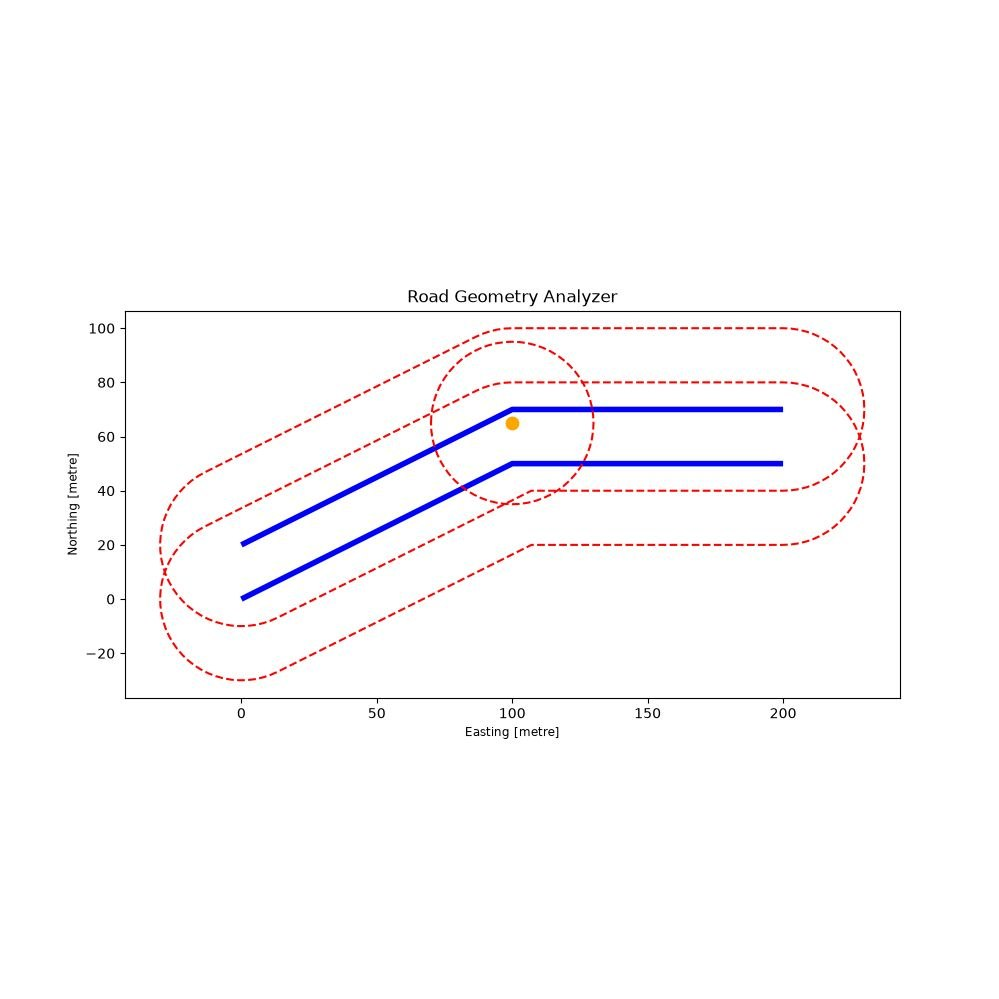
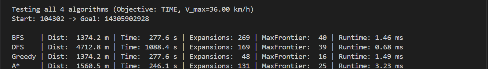
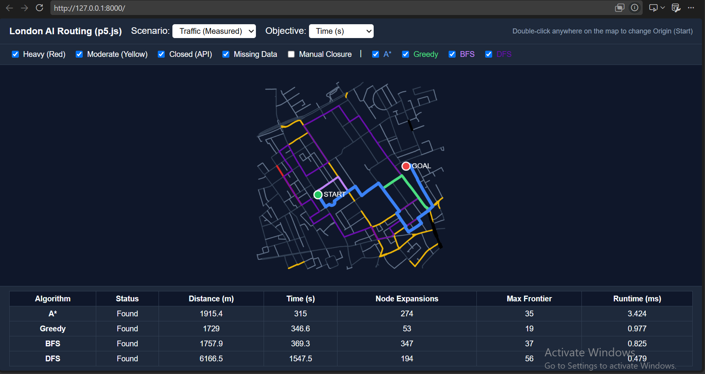

# London_Traffic

## Authors

- Saba Najafian
- Saba Gorji
- Parmis Solgi

Course: Artificial Intelligence, Fall 2026, KNTU
Instructor: Dr. Maryam Abdolali

## The Problem

The shortest road is not always the fastest one. A short route through a jammed junction can take longer than a longer route where traffic keeps moving.

In this project we test that idea on a real map of central London. We take the road network from OpenStreetMap, add **real TomTom traffic data**, and compare four search algorithms that we wrote ourselves: **BFS, DFS, greedy best-first search and A\***.

## What We Did

**1. Built the map.** We download a small drivable part of London with OSMnx and keep it as a directed graph, so one-way streets are respected. Road lengths are in meters, and parallel edges between the same two nodes keep their own identity (`(u, v, key)`) in the search.

**2. Added live traffic.** We ask the TomTom Flow Segment Data API for speeds near road midpoints, match each answer to OSM edges, and store a current speed and a free-flow speed on the edge. Travel time is

```
t = 3.6 * length / speed      (length in meters, speed in km/h)
```

**3. Compared the algorithms.** Each search runs with two goals (shortest distance or shortest time) in three situations: **free flow**, **measured traffic**, and **measured traffic plus one closed directed edge**. For every run we record route distance, travel time, runtime, node expansions and maximum frontier size.

## How It Works

```
downloading_graph.py  ->  data/graph/london.graphml
collect_traffic.py    ->  data/traffic_snapshot.json   (TomTom + matching)
```

Behind these scripts:

- `load_graph.py` loads the saved graph.
- `traffic_api.py` calls TomTom and cleans the answer.
- `traffic_matching.py` matches TomTom segments to OSM edges.
- `graph_weights.py` builds the three scenario graphs.
- `search_algorithm.py` holds the four algorithms.

## The Map

`downloading_graph.py` downloads the drivable roads within **750 m** of `(51.5215, -0.1300)` with `simplify=True` and saves them to `data/graph/london.graphml`:

```python
G = ox.graph_from_point(
    (51.5215, -0.1300), dist=750, network_type="drive", simplify=True
)
ox.save_graphml(G, filepath="./data/graph/london.graphml")
```

The saved graph has 439 nodes and 880 edges.

## Traffic API
To get data from the tom tom api we had to first register in the tomtom site and then get an api key specific for the traffic flow segments. 
Then we are going to place the key in our `.env` file in the `TOMTOM_API_KEY_2` and later on load it using the dot env function.
We have to give some parameters to our request function including the lat and long of the segment that we want, the speed measurement and openLr
this will return a json containing the information of the requested segment. Using this information we can create a geo data for that segment 
which we are going to validate for further spatial analysis.

## Traffic Matching

The tomtom segments don't always match the osmnx graph edges. These segments may contain multiple osmnx edges whose coordinates doesn't exactly
match those defined in the osmnx.So, we can't exactly use the latitude and longitude to match a road in the graph to a traffic speed. 
So, we have to use some spatial analysis to match these two maps.
First to match a segment with a road we have to define their direction and heading in the overall world map. NSEW then we will find 
the heading difference between them and minimize this difference as the 20 is more similar to 340 than 60. This direction and heading
similarity will give a corresponding score to that matching.
Another factor would be calculating overlap ratio of the geometries. We are going to give each tom tom segment a buffer and use that buffer 
to find all the intersecting osmnx roads that could be considered candidates for our matching. These are the candidates that we are
going to assign the scores to and then sort and use them based on these scores. 
Also as a reminder each segment isn't essentially matching to a single edge it could contain and match multiple edges of our graph.
This is a small experiment regarding matching the maps and spatial analysis and the practical use of buffering to determine which line or assumed roads contain our target point visualized.
This experiment will inspect our graph it will return the number of the edges and nodes. 
It will give us some samples of the possible edges and nodes and how they should be handled and what data each one contains. 
Then we will convert the given graph into a geodataframe for better accessibility and get the nodes and edges as geo data frame with each their own geo objects. 
We can even change its crs and create a projected geo data frame and at last it runs a simple visualization test.



## Traffic Data

### Getting it

`collect_traffic.py` walks over the graph edges, queries TomTom at each edge midpoint (zoom 18, speeds in km/h), and saves the matches:

- at most **200 queries** per run (`MAX_QUERIES`), with a short pause between requests
- edges that were already matched by an earlier query are skipped
- the snapshot is saved as `data/traffic_snapshot.json` with a UTC `collected_at` time
- the collection interval and the traffic coverage are printed at the end

All algorithms and scenarios use this one saved snapshot.

### Matching TomTom to OSM

For every TomTom segment we look at OSM edges within 25 m and give each a score:

```
score = 0.7 * overlap + 0.3 * direction_similarity
```
`overlap` is the share of the OSM edge that lies within 10 m of the TomTom line, and `direction_similarity` compares the headings of the two lines. Edges with a score of at least **0.55** get that segment's speeds. Matching is done in a projected CRS so distances are in meters.

### Cleaning it

Every answer gets one status (`classify_traffic` in `traffic_api.py`):

| Status | When | What we do |
|--------|------|------------|
| `closed` | TomTom reports a road closure | edge is removed from the graph |
| `missing` | speed, free-flow speed or confidence is absent | not used as a measurement |
| `unreliable` | confidence < 0.5 | not used as a measurement |
| `invalid_speed` | current or free-flow speed is zero or negative | not used as a measurement |
| `valid` | everything above passes | used |
| `unmatched` | no TomTom segment matched this edge | not used as a measurement |

Edges that are not `valid` still need a cost so the graph does not fall apart. For those we use the OSM speed limit (`maxspeed`, with mph converted to km/h, or 30 km/h if there is none). They are labeled as missing data, separately from real measurements.
This keeps the graph connected, but it means these edges are assumed to move at the speed limit, so real jams on roads without data are not seen by the search. In our snapshot, 356 of 880 edges (about 40%) had no traffic data and used the speed limit.

### Colors

With r = current speed / free-flow speed:

- **red**: r < 0.5
- **yellow**: 0.5 <= r < 0.8
- no overlay: r >= 0.8
- "missing" label: every edge that is not `valid`

### Snapshot details

- **Collected at:** 2026-11-20, about 10:48 to 10:51 UTC
- **Collection interval:** 204.8 seconds
- **Edges in graph / valid edges / coverage:** 880 / 520 / 59.1%

## Scenarios

`build_scenario_graph(G, scenario)` in `graph_weights.py` returns a graph and its V_max:

| Scenario | Speeds used | Extra |
|----------|-------------|-------|
| `free_flow` | free-flow speed on valid edges | closed edges removed |
| `traffic` | current speed on valid edges | closed edges removed |
| `closure` | same as `traffic` | one more directed edge removed |

Every edge gets both `weight_distance` (meters) and `weight_time` (seconds), and V_max is the highest speed used anywhere in that scenario graph.

## The Algorithms

All four are in `search_algorithm.py` and return the same kind of result:

```python
from search_algorithm import SearchAlgorithm

solver = SearchAlgorithm(G_scenario, objective="time", v_max=vmax)   # or "distance"
res = solver.a_star(start_node, goal_node)    # also: bfs, dfs, greedy

res["nodes"]               # route as nodes
res["edges"]               # route as (u, v, key), parallel edges kept
res["total_distance_m"], res["total_time_s"]
res["node_expansions"], res["max_frontier_size"], res["runtime_s"]
```

| Goal | Edge cost | Heuristic |
|------|-----------|-----------|
| `distance` | road length | straight-line distance to the goal |
| `time` | travel time | 3.6 * distance / V_max |

```python
def heuristic(self, node, goal):
    d = ox.distance.great_circle(y1, x1, y2, x2)      # meters
    if self.objective == "distance":
        return d
    return (3.6 * d) / self.v_max                      # seconds
```

**Why the time heuristic is admissible.** A straight line is never longer than a road path, and no edge can be driven faster than V_max. So the real remaining time is at least 3.6 * d / V_max. It is also consistent, because every edge costs at least 3.6 * (straight distance between its ends) / V_max.

How each one behaves:

- **BFS** explores level by level and ignores weights, so it finds the route with the fewest road segments, not the shortest or fastest one.
- **DFS** (iterative, with an explored set to handle cycles) ignores weights too. Its route depends on the order neighbors are visited, so we visit them in sorted node order to keep it deterministic.
- **Greedy** always expands the node that looks closest to the goal (lowest h). It is fast but can return a worse route.
- **A\*** expands the node with the lowest g + h and finds the best route for the chosen goal.

Ties are always broken by node id, and among parallel edges by the cheapest one (smallest key on ties), so results are repeatable.

`max_frontier_size` is the largest size of the queue, stack or heap. For A\* and DFS it can include duplicate entries for a node.

## Visualization

To make it easier to explore the London road network and visually compare how each search algorithm behaves under different traffic conditions, I built a lightweight interactive web visualization using Python and **p5.js**.

### Architecture
Instead of relying on heavy web frameworks, the visualization uses a simple client–server setup:
* **Backend (`visualization.py`):** Uses Python's built-in `http.server` (`ThreadingHTTPServer`) with zero extra web dependencies. At startup, it pre-loads the London OSM graph, applies the TomTom traffic snapshot, and pre-builds all three scenario graphs (`free_flow`, `traffic`, and `closure`) in memory so route recalculations happen almost instantly. It exposes two JSON endpoints:
  * `/api/traffic` — sends the road network geometry categorized by traffic status and color.
  * `/api/route` — takes a starting coordinate `(lat, lon)`, scenario, and objective (`time` or `distance`), snaps to the nearest graph node, runs all four search algorithms (`BFS`, `DFS`, `Greedy`, and `A*`), and returns their exact parallel-edge `(u, v, key)` geometries along with performance metrics.
* **Frontend (`static/index.html` & `static/app.js`):** Renders the road network on an interactive **p5.js** canvas, projecting `(lat, lon)` coordinates onto the screen while preserving the map's aspect ratio.

### Key Features
* **Double-Click to Change Origin:** Double-clicking anywhere on the map snaps to the nearest intersection, moves the green **START** marker, and immediately recalculates all four routes to the fixed **GOAL** node.
* **Scenario & Objective Switching:** Dropdown menus at the top let you switch between `Traffic (Measured)`, `Free-Flow`, and `Manual Closure` scenarios, as well as between `Time (s)` and `Distance (m)` objectives.
* **Toggleable Map Layers:** Checkboxes allow you to turn individual traffic layers (Heavy/Red, Moderate/Yellow, API Closed, Missing Data, Manual Closure) and algorithm routes (`A*`, `Greedy`, `BFS`, `DFS`) on or off.
* **Live Comparison Table:** Displays real-time metrics for all four algorithms below the map, including total distance, travel time, node expansions, maximum frontier size, and runtime (in ms).

### How to Run
1. Make sure the `static/` folder containing `index.html` and `app.js` is in the same directory as `visualization.py`.
2. Start the local server from your terminal:
   ```bash
   python visualization.py

## Project Structure

```
.
├── src/
│   ├── downloading_graph.py    # download and save the OSM graph (run once)
│   ├── load_graph.py           # load the saved graph
│   ├── traffic_api.py          # TomTom requests, cleaning, save/load snapshot
│   ├── traffic_matching.py     # match TomTom segments to OSM edges
│   ├── collect_traffic.py      # collect and save one traffic snapshot
│   ├── graph_weights.py        # free-flow / traffic / closure graphs
│   ├── search_algorithm.py     # BFS, DFS, greedy, A*
│   └── experiments/            # practice scripts for shapely,geopandas, OSMnx 
│
interactive map
│    ├── visualization.py       # it is the back-end of our interactive map
│    ├── static
│    │   ├──app.js              # it is the front-end of our interactive mao
│    │   ├──index.html
├── data/                       # graph and snapshot (not committed, see .gitignore)
├── cache/                      # OSMnx cache (not committed)
├── notebook.ipynb
├── requirements.txt
└── README.md
```

## Setup

```bash
git clone https://github.com/Zephyrus8406/London_Traffic.git
cd London_Traffic
python -m venv .venv
source .venv/bin/activate        # Windows: .venv\Scripts\activate
pip install -r requirements.txt
```

The code needs OSMnx 2.x, NetworkX, GeoPandas, Shapely, requests and python-dotenv (matplotlib is only used in the practice scripts).

### TomTom API key

Get a key from the TomTom developer portal and put it in a file named `.env` in the project root:

```
TOMTOM_API_KEY_2=your_key_here
```

`.env` is in `.gitignore`, so the key is never committed. Follow TomTom's rules for storing and sharing traffic data, and stay within the free allowance.

## How to Run

Run everything from the project root, because the scripts use paths like `./data/...`.

For the right outcome run the project's files in this order:
```bash
python src/downloading_graph.py
python src/load_graph.py
python src/visualization.py
```
`data/` is not committed, so anyone who clones the repo has to run these two steps first.

```bash
python src/downloading_graph.py    # 1. download the map (once)
python src/collect_traffic.py      # 2. collect one traffic snapshot
```

Most modules also have a small test in their `__main__` block, for example `python src/graph_weights.py`.

## Results

## Search Algorithm Results & Analysis

To validate the search implementations against real-world traffic conditions, all four algorithms (`BFS`, `DFS`, `Greedy`, and `A*`) were tested on the measured London traffic graph under the **TIME** objective ($V_{\max} = 36.00\text{ km/h}$) from node `104302` to node `14305902928`[cite: 1]. The results below highlight the practical trade-offs between optimality, node expansions, memory usage, and runtime.

### Benchmark Comparison


### Algorithm Performance Comparison

* **A\* (Optimal & Traffic-Aware):** A\* found the fastest route at **246.1 s**, saving **31.5 seconds** compared to both BFS and Greedy[cite: 1]. Notably, its chosen path is **186.3 m longer** (`1560.5 m` vs. `1374.2 m`), demonstrating that it successfully detoured around congested road segments rather than blindly taking the shortest geometric path[cite: 1].
* **BFS (Uninformed & High Overhead):** Because BFS ignores edge weights and expands level-by-level, it expanded the highest number of nodes (`269`) and reached the largest frontier (`40`)[cite: 1]. It returned a shorter-distance path (`1374.2 m`) that suffered from heavier traffic (`277.6 s`)[cite: 1].
* **DFS (Non-Optimal & Structure-Dependent):** DFS explored deeply based on deterministic neighbor ordering without considering distance or traffic, resulting in a heavily detoured path of **4712.8 m** taking **1088.4 s**—more than four times slower than A\*[cite: 1]. However, simple stack operations gave it the fastest raw runtime (`0.68 ms`)[cite: 1].
* **Greedy Best-First Search (Fast Exploration, Suboptimal Route):** Guided solely by the heuristic $h(n)$, Greedy reached the goal with the fewest expansions (`48`) and smallest frontier (`16`)[cite: 1]. Because it ignores accumulated travel time $g(n)$, it missed the faster detour and settled on the same suboptimal `277.6 s` route as BFS[cite: 1].

### Why the Implementation Produces Valid Results

The consistency of these outcomes directly reflects key design choices in `search_algorithm.py`:

* **Admissible Time Heuristic:** For the `time` objective, the heuristic computes $h(n) = \frac{3.6 \times d(n, G)}{V_{\max}}$ using great-circle distance and the graph's maximum speed ($V_{\max} = 36.00\text{ km/h}$)[cite: 1]. Because no vehicle can exceed $V_{\max}$, $h(n)$ never overestimates the true remaining travel time, guaranteeing that A\* finds the optimal `246.1 s` path[cite: 1].
* **Strict Unweighted Search for BFS & DFS:** Both uninformed algorithms select edges without inspecting `weight_time` or `weight_distance`, only summing the actual path metrics afterward during path reconstruction. This accurately exposes their inability to adapt to traffic congestion.



### Interactive Map Output Analysis

The screenshot above shows the live **p5.js** visualization running under the **Traffic (Measured)** scenario with the **Time (s)** objective[cite: 2]. All four search algorithms (`A*`, `Greedy`, `BFS`, and `DFS`) are overlaid simultaneously on the London road network alongside the active traffic layers (`Heavy`, `Moderate`, `Closed`, and `Missing Data`)[cite: 2].

| Algorithm | Status | Distance (m) | Time (s) | Node Expansions | Max Frontier | Runtime (ms) |
| :--- | :---: | :---: | :---: | :---: | :---: | :---: |
| **A\*** | Found | 1915.4| **315**| 274| 35| 3.424|
| **Greedy** | Found| **1729**| 346.6| **53**| **19**| 0.977|
| **BFS** | Found| 1757.9| 369.3| 347| 37| 0.825|
| **DFS** | Found| 6166.5| 1547.5| 194| 56| **0.479**|

#### Key Visual & Quantitative Takeaways
* **A\* (Blue Path — Fastest Route):** A\* achieves the optimal travel time of **315 s**, outperforming Greedy by **31.6 s** and BFS by **54.3 s**[cite: 2]. Visually, you can see the blue path taking a slightly longer southern detour (`1915.4 m`) to bypass slower segments and reach the goal faster.
* **Greedy Best-First Search (Green Path — Most Efficient Exploration):** Greedy heads straight toward the goal, achieving the shortest distance (`1729 m`), fewest node expansions (`53`), and smallest frontier (`19`)[cite: 2]. However, because it ignores actual traffic costs, it takes **346.6 s**.
* **BFS (Uninformed Baseline):** Expanding level-by-level results in the highest number of node expansions (`347`) and a slower travel time of **369.3 s** (`1757.9 m`).
* **DFS (Purple Path — Severe Detour):** As clearly visible on the canvas, DFS wanders through the northern and western edges of the network before reaching the goal, producing a **6166.5 m** route that takes **1547.5 s** (nearly five times slower than A\*), despite having the lowest raw runtime (`0.479 ms`) due to simple stack operations.


## Resources

- [OSMnx](https://osmnx.readthedocs.io/)
- [TomTom Flow Segment Data API](https://developer.tomtom.com/traffic-api/documentation/traffic-flow/flow-segment-data)
- TomTom free allowance and terms (see the TomTom developer portal)
